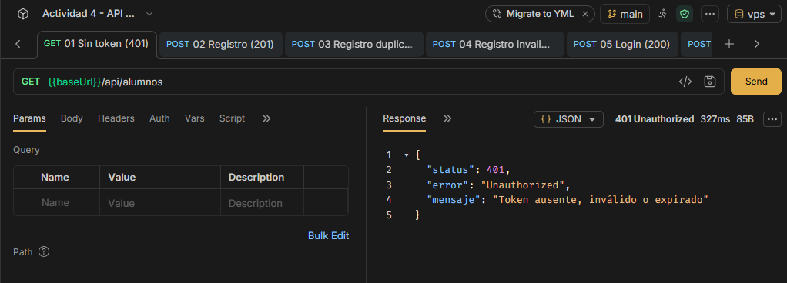
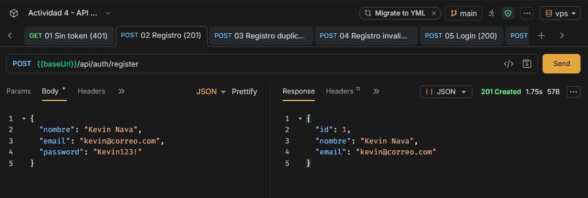
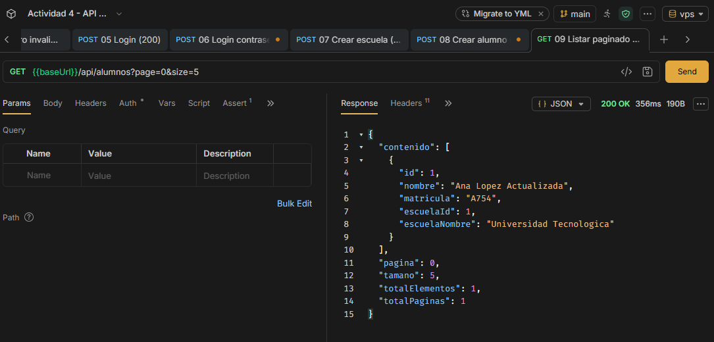
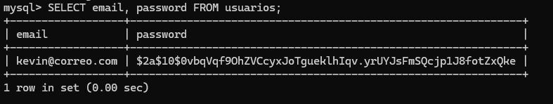
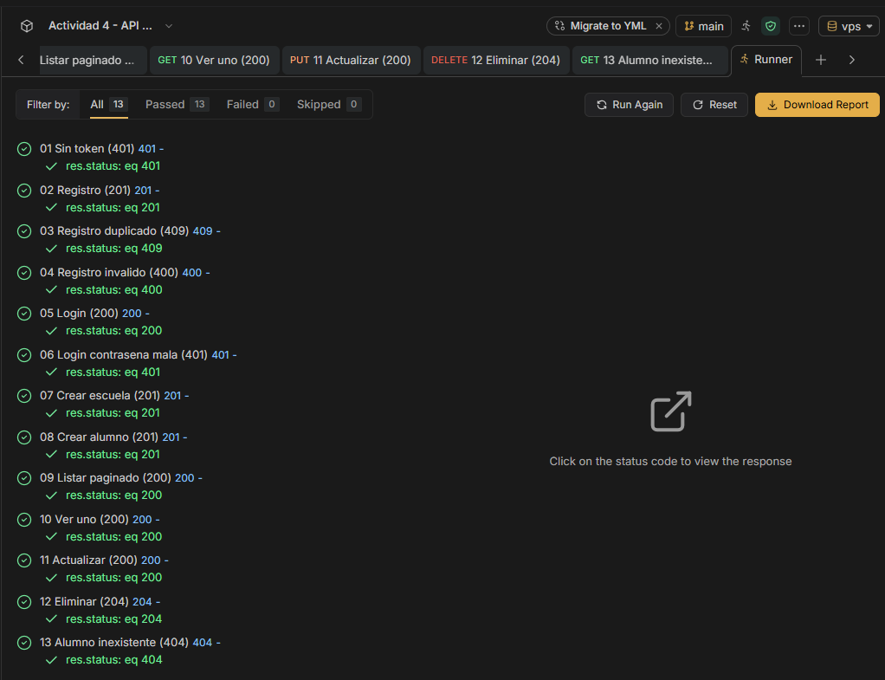

# Actividad 4: API REST con Spring Security y JWT

API REST construida con Spring Boot que permite registrar usuarios, iniciar sesión y obtener un token JWT. Con ese token se accede a un CRUD protegido de alumnos y escuelas.

- **Alumno:** Kevin Peralta Nava Peralta

- **Materia:** Programación Web

**URL base (VPS):** `http://94.130.98.27:2757`

---

## Estructura del proyecto

```
spring-actividad4/
├── bruno/                  Colección de Bruno (entornos local y vps)
├── docs/img/               Capturas del README
├── src/main/java/com/actividad3/crud_spring/
│   ├── config/             SecurityConfig
│   ├── controller/         AuthController, AlumnoController, EscuelaController
│   ├── dto/                Request y Response (DTOs)
│   ├── exception/          GlobalExceptionHandler, ErrorResponse
│   ├── model/              Entidades (Usuario, Rol, Alumno, Escuela)
│   ├── repository/         Repositorios JPA
│   ├── security/           JwtService, JwtAuthenticationFilter, UsuarioDetailsService
│   └── service/            AuthService, AlumnoService
└── pom.xml
```

## Endpoints

### Públicos

| Método | Ruta | Descripción | Respuesta |
|---|---|---|---|
| POST | `/api/auth/register` | Registra un usuario | 201 |
| POST | `/api/auth/login` | Inicia sesión y devuelve el token | 200 |

**Reglas de la contraseña:** mínimo 8 caracteres, con al menos una mayúscula, un número y un carácter especial. Se guarda con BCrypt.

### Protegidos (requieren `Authorization: Bearer <token>`)

| Método | Ruta | Descripción | Respuesta |
|---|---|---|---|
| GET | `/api/alumnos?page=0&size=5` | Lista paginada | 200 |
| GET | `/api/alumnos/{id}` | Ver un alumno | 200 / 404 |
| POST | `/api/alumnos` | Crear alumno | 201 |
| PUT | `/api/alumnos/{id}` | Actualizar alumno | 200 / 404 |
| DELETE | `/api/alumnos/{id}` | Eliminar alumno | 204 / 404 |
| GET | `/api/escuelas` | Listar escuelas | 200 |
| GET | `/api/escuelas/{id}` | Ver una escuela | 200 / 404 |
| POST | `/api/escuelas` | Crear escuela | 201 |

### Ejemplos de cuerpo

Registro:
```json
{ "nombre": "Kevin Nava", "email": "kevin@correo.com", "password": "Kevin123!" }
```

Login:
```json
{ "email": "kevin@correo.com", "password": "Kevin123!" }
```

Alumno:
```json
{ "nombre": "Ana Lopez", "matricula": "A1001", "escuelaId": 1 }
```

## Pruebas con Bruno

La colección está en la carpeta `bruno/`.

1. Abre Bruno y elige **Open Collection** > carpeta `bruno`.
2. Selecciona el entorno `local` o `vps`.
3. Ejecuta primero `05 Login`, que guarda el token automáticamente.
4. Para correr todo junto: clic derecho en la colección > **Run**.

| # | Petición | Resultado esperado |
|---|---|---|
| 01 | Sin token | 401 |
| 02 | Registro | 201 |
| 03 | Registro duplicado | 409 |
| 04 | Registro inválido | 400 |
| 05 | Login | 200 + token |
| 06 | Login con contraseña incorrecta | 401 |
| 07 | Crear escuela | 201 |
| 08 | Crear alumno | 201 |
| 09 | Listar paginado | 200 |
| 10 | Ver uno | 200 |
| 11 | Actualizar | 200 |
| 12 | Eliminar | 204 |
| 13 | Alumno inexistente | 404 |


## 8. Capturas

### Petición sin token (401)


### Login con token


### Petición protegida con token (200)


### Contraseña cifrada con BCrypt en MySQL


### Runner de Bruno en el VPS


